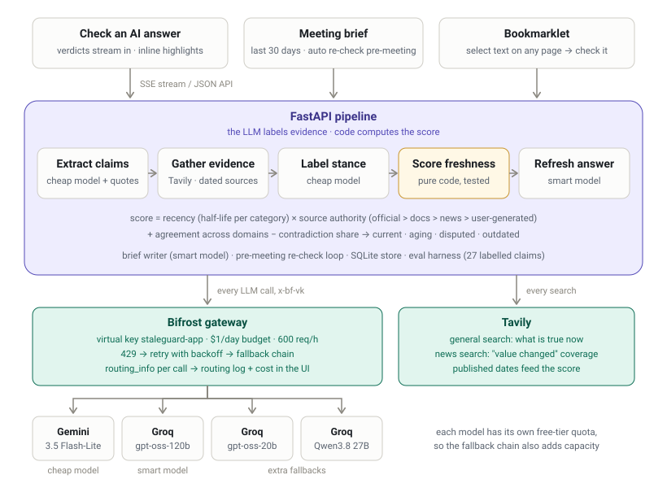

# StaleGuard

**Finds the parts of an AI answer that have gone out of date, checks each one against the live web, and gives it an explainable freshness score. It also writes pre-meeting briefs and verifies every line of them the same way.**

Built for the Geek Room **Global AI Hackathon**:
- **Primary:** [Tavily] Build a Stale-Answer Detector for AI Applications (Tavily + Bifrost)
- **Also covers:** [Tavily] Tavily Research Agent (pre-meeting brief, last 30 days, source-backed)

| | |
|---|---|
| **Accuracy** | 19/19 on the tuning set (stable over 2 runs), **8/8 on a held-out set never used for tuning**, which includes a CEO change from 8 days before the eval ([eval/](eval/README.md)) |
| **Cost** | about $0.001 per claim checked, about $0.008 per typical answer (list prices; free tiers in practice) |
| **Score** | computed by tested code from dates, source authority and agreement. The LLM only labels evidence |

---

## The problem

LLMs answer from training data that is months or years old, and they sound just as sure about a 2023 price as about a law of physics. Users can't tell which sentences are still true. Asked today, a model may still say Jerome Powell chairs the Fed, Python 3.14 is the newest release, or Tim Cook runs Apple. None of those is true any more (November 2026).

Meeting-prep agents have the same flaw: a brief written yesterday can be wrong by the time the meeting starts.

## What StaleGuard does

### 1. Check an AI answer (stale-answer detector)
Paste any LLM answer, or select it on any page and click the **bookmarklet**. StaleGuard:

1. **Extracts only the time-sensitive claims** (prices, versions, who holds a role, funding, regulation, statistics, "latest X") and finds where each one sits in your text.
2. **Re-checks each claim on the live web** with Tavily, using two complementary searches:
   - a neutral one ("UK Prime Minister") to find what is true now;
   - a news search on the claim itself ("Keir Starmer is the Prime Minister") to find reports that it changed.
3. Has a **cheap model label each source** *supports / contradicts / unrelated*.
4. **Computes a freshness score (0-100) in code** and a verdict: `current · aging · disputed · outdated · unverified`.
5. **Streams the results:** your answer appears with each claim underlined in its verdict colour as soon as its check finishes. Hover a claim to see what live sources say now, and the dated evidence behind it.
6. Writes a **refreshed answer** with every correction marked `[updated: source]`.

### 2. Meeting brief (research agent)
Enter a company or person and a meeting time. StaleGuard:
1. Researches the **last 30 days** from five angles (news, funding, launches, leadership, deals and legal). It keeps only sources that actually name the subject.
2. Writes a **one-page brief**: summary, dated developments with citations, talking points, open questions, watch-outs.
3. **Runs every development through the stale-answer engine**, so each line carries a verdict badge.
4. **Re-checks the brief automatically shortly before the meeting** (default 90 min) and logs what changed. You can also re-check by hand or print it to PDF.

## How the freshness score works

The LLM never makes up the score. It only labels evidence; [app/scoring.py](app/scoring.py) does the rest, and its rules are covered by tests.

**1. Recency, by category.** Each kind of fact has a half-life: how fast it goes stale.

| pricing | api_version | product | funding · event | leadership · statistic | regulation | other |
|---|---|---|---|---|---|---|
| 45 d | 60 d | 90 d | 120 d | 180 d | 240 d | 365 d |

`recency = 0.5 ^ (age_days / half_life)`. A source with no date counts at a fixed 0.35.

**2. Source authority, from the URL alone (no LLM).**

| Tier | Examples | Weight |
|---|---|---|
| Official / government | `.gov`, `europa.eu`, the subject's own site (stripe.com for Stripe) | ×1.5 |
| Docs / changelogs | `docs.*`, `/release-notes`, `/changelog` | ×1.4 |
| Reference, major news | Wikipedia, Britannica · Reuters, Bloomberg, FT, CNBC… | ×1.2 |
| Everything else | | ×1.0 |
| User-generated | YouTube, X, Reddit, Medium | ×0.6 |

Reference and docs pages are **living documents**: search engines report the date a page was *created*, not its last edit (Tavily dates Wikipedia's Python page 2009). Their dates are ignored. They count at a fixed 0.6 × authority, and never make a claim look older than it is.

**3. Combine.** With `weight = recency × authority`:

```
freshness = 100 × ( 0.5 × strongest support weight
                  + 0.25 × agreement (supporting domains / 3, capped at 1)
                  + 0.25 × (1 − contradiction share) )
```

- **outdated**: contradiction holds ≥ 60% of the weight, or ≥ 40% and is newer than the newest support.
- **disputed**: contradiction holds ≥ 20% of the weight.
- **aging**: only old sources support it.
- **current**: otherwise.

Every verdict shows its reasons in plain words ("Official/docs sources weigh more: nvidia.com", "Dates ignored for maintained pages: wikipedia.org"), next to the dated evidence.

## Accuracy

[eval/run_eval.py](eval/run_eval.py) runs hand-labelled claims through the same `verify_claim` the app uses, with live search and live models. Ground truth was checked against live sources on 2026-11-20 and is recorded with each claim.

| Set | Claims | Result |
|---|---|---|
| Golden, before tuning | 19 | 18/19 (95%) |
| Golden, after tuning | 19 | 19/19 (100%), on 2 separate runs |
| **Held-out**, written after tuning and run once | **8** | **8/8 (100%)** |

Both sets mix facts that went stale long ago, facts that **changed in the last ~18 months** (Fed chair May 2026, UK PM July 2026, Python 3.15 Oct 2026, Apple CEO Sept 2026, Nvidia CEO 12 Nov 2026) and facts that are still true.

Every fix from tuning is a general rule, not a claim-specific patch; the list is in [eval/README.md](eval/README.md). The eval is small (27 claims) and leans towards leadership and version facts. Contested numbers such as valuations and regional prices are under-represented.

## Architecture



### How each sponsor technology is used

| | Role in StaleGuard |
|---|---|
| **Tavily** | All live research. Each claim gets a general search (current state) and a `topic=news` search on the claim itself (change coverage), with `include_published_date` so every source carries a date for the score. The brief's 30-day research uses five news angles. Dates are normalised; Google-News redirects are labelled and duplicate articles dropped. |
| **Bifrost** | Every LLM call goes through it, authenticated by a **virtual key** with a **daily USD budget** and an **hourly rate limit**. Bifrost prices each call from its model catalog and returns 402 when the budget is spent. **Two-tier routing:** a cheap model for extraction and stance labelling, a stronger model only for writing. **Automatic fallback** across four models with separate free-tier quotas, plus retry-with-backoff on 429s. The UI shows a **routing log** from Bifrost's `routing_info` (requested model, model that served it, fallback or not, tokens, time) and the key's **live budget**, read from Bifrost's governance API. |

### Demo the fallback
Tick **Simulate provider outage** before a check. Every call then asks Bifrost for `gemini-2.5-flash` first, a model Google has retired. The provider genuinely rejects it, Bifrost serves the call from the next model in the chain, and the usage panel shows *"Bifrost fallback × 9 … served by …"* with the full routing log. Set `DEMO_OUTAGE_MODEL` to choose a different model.

## Run it

Needs: Windows PowerShell (the scripts are .ps1), Node.js 18+ for Bifrost, Python 3.10+ or [uv](https://docs.astral.sh/uv/), and three free keys:
- [Tavily](https://app.tavily.com)
- [Gemini](https://aistudio.google.com) (Google AI Studio → Get API key)
- [Groq](https://console.groq.com) (API Keys)

```powershell
# 1. Create .env and fill in TAVILY_API_KEY, GEMINI_API_KEY, GROQ_API_KEY
Copy-Item .env.example .env

# 2. Start the gateway. Writes bifrost-data\config.json from .env and generates the
#    app's virtual key (BIFROST_VIRTUAL_KEY) and dashboard setup token into .env
.\scripts\start-bifrost.ps1

# 3. In a second terminal: creates the venv, installs deps, starts the app
.\scripts\start-app.ps1

# 4. Open http://localhost:8000
```

- **Offline demo:** set `STALEGUARD_MOCK=1` in `.env` to run with canned data and no keys.
- **Tests:** `.\.venv\Scripts\python -m pytest -q` (22 tests, mock mode, no keys needed).
- **Eval:** `.\.venv\Scripts\python -m eval.run_eval` and `--set holdout`. These run live and use about 35 Tavily searches each.
- **Free-tier limits:** Gemini allows 15 requests/min and Groq 8k tokens/min per model. One check fits easily; the fallback chain absorbs bursts. If Gemini is slow, `MODEL_FAST=groq/openai/gpt-oss-20b` is about twice as fast (7/8 on the held-out set).
- **Bookmarklet:** drag **✓ StaleGuard it** from the app to your bookmarks bar. Select an answer on any page and click it.

### API

| Method | Path | |
|---|---|---|
| `POST` | `/api/verify/stream` | Server-sent events: `claims`, one `result` per claim as each finishes, `refresh`, `done` (full report) |
| `POST` | `/api/verify` | `{ "text", "as_of"?, "simulate_outage"? }` returns the full report as JSON |
| `POST` | `/api/briefs` | `{ "entity", "meeting_time" (ISO), "purpose"?, "simulate_outage"? }` returns a verified brief |
| `POST` | `/api/briefs/{id}/recheck` | re-verifies with fresh searches and logs changes |
| `GET` | `/api/budget` | the Bifrost virtual key's spend vs budget and rate-limit usage |
| `GET` | `/api/briefs`, `/api/briefs/{id}`, `/api/reports/{id}`, `/api/health` | |

`/api/verify` is a plain JSON API, so any LLM app can send its answers through StaleGuard before showing them to users.

## Project layout

```
app/llm.py       only place that calls an LLM: Bifrost, virtual key, fallbacks, routing log, outage switch
app/search.py    only place that calls Tavily: dates, de-duplication, 10-min cache
app/claims.py    claim extraction + locating each claim in the input
app/verify.py    evidence gathering + stance labelling per claim
app/scoring.py   deterministic score: half-lives, source authority, verdict rules
app/brief.py     30-day research + brief writer
app/pipeline.py  streaming verify, briefs, re-checks, pre-meeting scheduler
static/          vanilla HTML/CSS/JS, no build step
eval/            golden + held-out claim sets, runner, results
```

## Limits

- Verdicts depend on what the web says today. When sources disagree, StaleGuard reports *disputed* rather than guessing.
- The source authority tiers are a hand-written list of domains, not a learned ranking.
- Single-user prototype: SQLite store, local Bifrost, no auth on the app itself.

## AI usage disclosure

- **In the product:** LLMs reached through Bifrost do four jobs: extract claims, label evidence, write briefs and rewrite answers. Gemini 3.5 Flash-Lite and Groq-hosted gpt-oss / Qwen models are used. Tavily provides the live web data. The freshness score is computed by code, not by a model.
- **In development:** built with help from Claude (Anthropic) via Claude Code as a coding assistant. That help covered code, tests, the eval harness and documentation. The eval ground truth was checked against live sources, and design decisions were reviewed by the author.

## Team

- Drako (DrakesINC)
